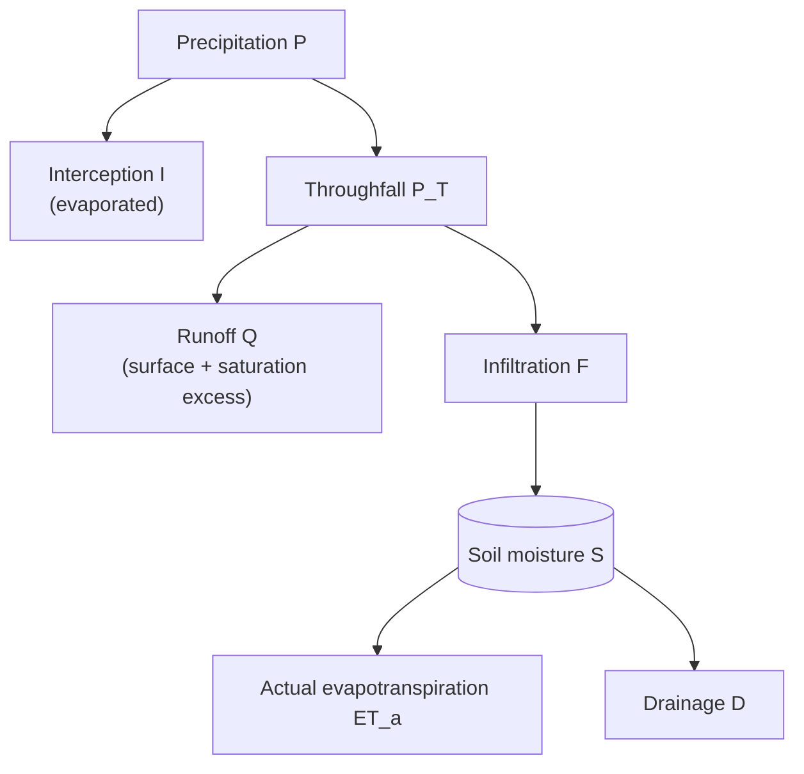

# Scientific background

The model is a single-layer "bucket": one soil water store holding the soil moisture $S$ (mm), with soil water capacity $S_{\max}$, stepped forward one week at a time.
It aims to reproduce the main ecohydrological controls on soil moisture with as few parameters as possible, so that it can be calibrated at individual sites and run cheaply over large grids.
It is not a process-detailed hydrological model.
Symbols and terms follow [Notation](notation.md).

Three things set the store's behaviour:

- **Soil texture.** Clay content changes the soil water capacity, drainage, runoff and the shape of the water-stress response.
- **Vegetation.** Plant biomass controls canopy interception, the crop coefficient and the uptake factor.
- **Climate.** Temperature drives evaporative demand and decides whether a week is frozen; precipitation supplies water.

## Weekly water balance

Each week $t$, starting from the soil moisture $S_{t-1}$ at the end of the previous week:

$$
S_t = S_{t-1} + P - I - Q - ET_a - D
$$

All terms are weekly totals in mm.
The model conserves water exactly: the test suite checks this identity every week.

### Interception and throughfall

Intercepted precipitation is limited by an interception capacity $f_B\,I_{\max}$ that grows with biomass (see [Biomass effects](#biomass-effects)), and it evaporates within the week:

$$
I = \min(P, f_B\,I_{\max}), \qquad P_T = P - I
$$

### Runoff and infiltration

Surface runoff takes a fraction of throughfall that rises with the relative soil moisture:

$$
Q_s = r_{\max} \left(\frac{S_{t-1}}{S_{\max}}\right)^{\gamma} P_T
$$

where $r_{\max}$ is the maximum runoff fraction, reached when the store is full, and $\gamma$ the runoff exponent.
Water that would then overfill the store also runs off, as saturation excess:

$$
Q_e = \max(S_{t-1} + P_T - Q_s - S_{\max},\ 0), \qquad Q = Q_s + Q_e, \qquad F = P_T - Q
$$

The store after infiltration is then $S^{+}_t = S_{t-1} + F \le S_{\max}$.

### Evapotranspiration

Reference evapotranspiration comes from a degree-day relation, scaled by elevation:

$$
ET_o = c_{ET} \cdot 7 \max(T - T_b,\ 0) \cdot m_z,
\qquad
m_z = \mathrm{clip}\left(1 + g_z \frac{z}{1000},\ m_{z,\min},\ m_{z,\max}\right)
$$

where $T$ is weekly mean air temperature (°C), $T_b$ the base temperature, $c_{ET}$ the calibrated reference ET coefficient (mm °C⁻¹ day⁻¹), $z$ the elevation (m), $g_z$ the elevation gradient (per km) and $m_z$ the elevation multiplier.

Potential evapotranspiration applies the crop coefficient $K_c$ and the uptake factor $u$, both of which rise with biomass:

$$
ET_p = u^{\mathrm{eff}} K_c\, ET_o^{\mathrm{eff}}
$$

The superscript $\mathrm{eff}$ marks the values after the [frozen-week adjustment](#frozen-weeks); in an unfrozen week they equal the plain ones.
$ET_p$ is not `[FAO56]`'s crop evapotranspiration $ET_c = K_c\,ET_o$, because of the uptake factor.

Actual evapotranspiration is reduced by the water-stress coefficient $K_s$ and cannot exceed the store after infiltration:

$$
K_s = \left(\frac{S^{+}_t}{S_{\max}}\right)^{\beta},
\qquad
ET_a = \min(K_s\, ET_p,\ S^{+}_t)
$$

The stress exponent $\beta$ increases with clay content, so clay soils hold water more tightly.
This $K_s$ is a power law in the relative store after infiltration, not `[FAO56]` eq. (84), which uses root-zone depletion.

### Drainage

A fixed fraction $k_d^{\mathrm{eff}}$ of the water above field capacity drains each week:

$$
D = k_d^{\mathrm{eff}} \max\left(S^{+}_t - ET_a - S_{fc},\ 0\right),
\qquad
S_{fc} = \phi_{fc} S_{\max}
$$

where $k_d$ is the drainage coefficient and $\phi_{fc}$ the field-capacity fraction, the field capacity $S_{fc}$ as a fraction of $S_{\max}$.

## Biomass effects

All biomass effects share a single saturating function of biomass $B$ (g C m⁻²), the biomass saturation $f_B$, with biomass half-saturation $K_B$:

$$
f_B = \frac{B}{B + K_B}
$$

Each effect then rises linearly in $f_B$, from its bare-soil value at $B = 0$ to its limit as $B \to \infty$:

$$
K_c = K_{c,\min} + (K_{c,\max} - K_{c,\min}) f_B,
\qquad
\text{interception capacity} = f_B\,I_{\max},
\qquad
u = 1 + (u_{\max} - 1) f_B
$$

## Clay effects

The calibrated soil parameters are nominal values, marked $\circ$, for a soil with the nominal clay content $C^{\circ}$.
For clay content $C$ (percent, clipped to between 0 and 80), let

$$
\Delta = \kappa \frac{C - C^{\circ}}{100}
$$

with clay sensitivity $\kappa$.
Each property is scaled linearly in the clay offset $\Delta$, with clay response factors $a_d$, $a_r$ and $a_\beta$, then clipped to a plausible range:

$$
\begin{aligned}
S_{\max} &= S_{\max}^{\circ}\,(1 + \Delta) \\
k_d      &= k_d^{\circ}\,(1 - a_d \Delta) \\
r_{\max} &= r_{\max}^{\circ}\,(1 + a_r \Delta) \\
\beta    &= \beta^{\circ}\,(1 + a_\beta \Delta)
\end{aligned}
$$

More clay therefore means more storage, slower drainage, more runoff and a steeper stress response.
A single shared sensitivity $\kappa$ keeps the parameter count down.

## Frozen weeks

A week is frozen when its mean air temperature is below the freezing temperature, $T < T_{\mathrm{frz}}$ (0 °C by default).
In a frozen week:

- only a fraction $\phi^{\mathrm{frz}}$ of throughfall infiltrates, and the rest runs off, so $Q_s = (1 - \phi^{\mathrm{frz}}) P_T$;
- reference evapotranspiration, the biomass-driven part of the uptake factor, and the drainage coefficient are each scaled down by a fixed multiplier:

$$
ET_o^{\mathrm{eff}} = m^{\mathrm{frz}}_{ET}\, ET_o,
\qquad
u^{\mathrm{eff}} = 1 + m^{\mathrm{frz}}_{u} (u - 1),
\qquad
k_d^{\mathrm{eff}} = m^{\mathrm{frz}}_{d}\, k_d
$$

This is a threshold on weekly air temperature, not a frozen-soil state: there is no memory of previous weeks, no lag, and no snowpack.

## Parameters and constants

The nine calibrated parameters are fields of [`SoilWaterParams`](API_Reference/params.md#soil_moisture_model.params.SoilWaterParams).
Every other number in the equations above is a field of [`ModelConstants`](API_Reference/params.md#soil_moisture_model.params.ModelConstants), with its default value, so sensitivity studies can vary them without editing the code.
The initial soil moisture $S_0$ is an argument of [`simulate`](API_Reference/model.md#soil_moisture_model.model.simulate) rather than a parameter.

### Calibrated parameters

::: soil_moisture_model.params.SoilWaterParams
    options:
      show_root_heading: false
      show_root_toc_entry: false
      show_signature: false
      show_bases: false
      show_docstring_description: false
      show_docstring_raises: false
      members: false
      summary:
        attributes: true
      docstring_section_style: spacy

### Fixed constants

::: soil_moisture_model.params.ModelConstants
    options:
      show_root_heading: false
      show_root_toc_entry: false
      show_signature: false
      show_bases: false
      show_docstring_description: false
      show_docstring_raises: false
      members: false
      summary:
        attributes: true
      docstring_section_style: spacy

## Limitations

- Evaporative demand depends on temperature only: there is no radiation, humidity or wind.
- Interception evaporates in full every week, regardless of evaporative demand.
- Freezing is diagnosed from air temperature alone; there is no snowpack.
- The single store has no vertical structure, so it cannot represent a wet surface over a dry subsoil.
- The time step is fixed at one week.
