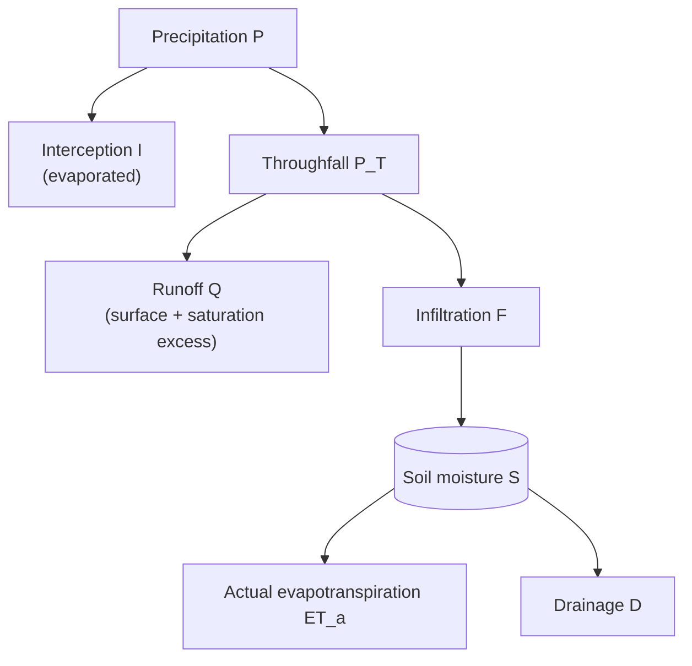

# Scientific background

The model is a single-layer "bucket": one soil water store holding the soil moisture $S$ (mm), the water above the wilting point over the rooting depth, with soil water capacity $S_{\max}$, stepped forward one week at a time.
It aims to reproduce the main ecohydrological controls on soil moisture with as few parameters as possible, so that it can be calibrated at individual sites and run cheaply over large grids.
It is not a process-detailed hydrological model.
Symbols and terms follow [Notation](notation.md).

Three things set the store's behaviour:

- **Soil and roots.** Sand, clay and organic matter set the water contents at wilting point, field capacity and saturation; the rooting depth sets how much of the soil profile the store covers.
- **Vegetation.** Plant biomass controls canopy interception and the crop coefficient.
- **Climate.** Temperature drives evaporative demand and decides whether a week is frozen; precipitation supplies water.

## Weekly water balance

Each week $t$, starting from the soil moisture $S_{t-1}$ at the end of the previous week:

$$
S_t = S_{t-1} + P - I - Q - ET_a - D
$$

All terms are weekly totals in mm.
The model conserves water exactly: the test suite checks this identity every week.
Evaporative losses are bounded by demand: $I + ET_a \le ET_p$.

### Interception and throughfall

Intercepted precipitation is limited by an interception capacity $f_B\,I_{\max}$ that grows with biomass (see [Biomass effects](#biomass-effects)), and by the potential evapotranspiration $ET_p$ (see [Evapotranspiration](#evapotranspiration)), and it evaporates within the week:

$$
I = \min(P,\ f_B\,I_{\max},\ ET_p), \qquad P_T = P - I
$$

Water the canopy holds but the week's demand cannot evaporate falls through to the soil, so a frozen week, with almost no demand, intercepts almost nothing.

### Runoff and infiltration

Surface runoff takes a fraction of throughfall that rises with the relative soil moisture:

$$
Q_s = r_{\max} \left(\frac{S_{t-1}}{S_{\max}}\right)^{\gamma} P_T
$$

where $r_{\max}$ is the maximum runoff fraction, reached when the store is full, and $\gamma$ the runoff exponent.
Water that would then overfill the store also runs off, as saturation excess:

$$
Q_e = \max(S_{t-1} + P_T - Q_s - S_{\max},\ 0), \qquad Q = Q_s + Q_e, \qquad F = P_T - Q
$$

The store after infiltration is then $S^{+}_t = S_{t-1} + F \le S_{\max}$.

### Evapotranspiration

Reference evapotranspiration comes from a degree-day relation, scaled by an elevation multiplier:

$$
ET_o = c_{ET} \cdot 7 \max(T - T_b,\ 0) \cdot m_z,
\qquad
m_z = \frac{\Delta + \gamma_{\mathrm{psy}}(0)}{\Delta + \gamma_{\mathrm{psy}}(z)}
$$

where $T$ is weekly mean air temperature (°C), $T_b$ the base temperature, $c_{ET}$ the calibrated reference ET coefficient (mm °C⁻¹ day⁻¹), $z$ the elevation (m) and $m_z$ the elevation multiplier.

The elevation multiplier is the equilibrium evaporation factor $\Delta / (\Delta + \gamma_{\mathrm{psy}})$ at the site, relative to sea level.
Here $\Delta$ is the slope of the saturation vapour pressure curve at $T$, `[FAO56]` eq. (13), and $\gamma_{\mathrm{psy}}(z)$ the psychrometric constant, `[FAO56]` eq. (8), at the atmospheric pressure of elevation $z$, `[FAO56]` eq. (7).
Lower pressure at altitude lowers $\gamma_{\mathrm{psy}}$, so at a given temperature demand rises with elevation, by about 4 % per kilometre at 20 °C.
The multiplier has no free parameters.

Alternatively, $ET_o$ can be passed to `simulate` directly, from any method that uses more than temperature, such as `[FAO56]` Penman–Monteith.
The degree-day relation, and with it the elevation multiplier and $c_{ET}$, is then not used.

Potential evapotranspiration applies the crop coefficient $K_c$, which rises with biomass:

$$
ET_p = K_c\, ET_o^{\mathrm{eff}}
$$

The superscript $\mathrm{eff}$ marks the values after the [frozen-week adjustment](#frozen-weeks); in an unfrozen week they equal the plain ones.
In an unfrozen week $ET_p$ is `[FAO56]`'s crop evapotranspiration $ET_c = K_c\,ET_o$.

Evaporating intercepted water uses part of the demand, and the rest, $ET_p - I$, draws on the store.
Actual evapotranspiration is that remaining demand reduced by the water-stress coefficient $K_s$, and cannot exceed the store after infiltration:

$$
K_s = \min\left(1,\ \frac{S^{+}_t}{(1 - p)\, S_{fc}}\right),
\qquad
ET_a = \min\left(K_s\, (ET_p - I),\ S^{+}_t\right)
$$

This is `[FAO56]` eq. (84), with the field capacity $S_{fc}$ (see [Soil texture and rooting depth](#soil-texture-and-rooting-depth)) as the total available water.
Evapotranspiration is unstressed until a fraction $p$, the depletion fraction, of the water held at field capacity has been used, and then falls linearly to zero as the store empties.
`[FAO56]` Table 22 gives $p$ between 0.3 and 0.7 by crop; the default is 0.5, which `[FAO56]` says is commonly used for many crops.

### Drainage

A fixed fraction $k_d^{\mathrm{eff}}$ of the water above field capacity drains each week:

$$
D = k_d^{\mathrm{eff}} \max\left(S^{+}_t - ET_a - S_{fc},\ 0\right)
$$

where $k_d$ is the drainage coefficient and $S_{fc}$ the field capacity.
Water between field capacity and saturation therefore stays in the store for some weeks, where `[FAO56]` would drain it within the day.

## Biomass effects

All biomass effects share a single saturating function of biomass $B$ (g C m⁻²), the biomass saturation $f_B$, with biomass half-saturation $K_B$:

$$
f_B = \frac{B}{B + K_B}
$$

Each effect then rises linearly in $f_B$, from its bare-soil value at $B = 0$ to its limit as $B \to \infty$:

$$
K_c = K_{c,\min} + (K_{c,\max} - K_{c,\min}) f_B,
\qquad
\text{interception capacity} = f_B\,I_{\max}
$$

## Soil texture and rooting depth

The store is the water above the wilting point within the rooting depth $Z_r$ (m).
Its field capacity and capacity follow from three volumetric water contents (m³ m⁻³):

$$
S_{fc} = 1000\,(\theta_{FC} - \theta_{WP})\,Z_r,
\qquad
S_{\max} = 1000\,(\theta_{sat} - \theta_{WP})\,Z_r
$$

$S_{fc}$ is `[FAO56]`'s total available water, eq. (82).
The water contents at wilting point (1500 kPa), field capacity (33 kPa) and saturation come from the `[SR06]` pedotransfer functions, eqs. (1), (2), (3) and (5), in the sand, clay and organic matter fractions.
`[SR06]`'s adjustment for bulk density is not applied.
Where the functions do not give $0 < \theta_{WP} < \theta_{FC} < \theta_{sat} \le 1$, which happens only for implausible texture such as pure sand or very high organic matter, the pixel's outputs are NaN.

The soil water content over the rooting depth, $\theta = \theta_{WP} + S / (1000\,Z_r)$, is an output, for comparison with observations and for models such as sgam that take volumetric water content.

The rooting depth $Z_r$ and the depletion fraction $p$ are properties of the vegetation, which `[FAO56]` Table 22 lists by crop.
Both are fields of `SoilWaterParams`, so they can vary per pixel, for example by plant functional type.

## Frozen weeks

A week is frozen when its mean air temperature is below the freezing temperature, $T < T_{\mathrm{frz}}$ (0 °C by default).
In a frozen week:

- only a fraction $\phi^{\mathrm{frz}}$ of throughfall infiltrates, and the rest runs off, so $Q_s = (1 - \phi^{\mathrm{frz}}) P_T$;
- reference evapotranspiration and the drainage coefficient are each scaled down by a fixed multiplier:

$$
ET_o^{\mathrm{eff}} = m^{\mathrm{frz}}_{ET}\, ET_o,
\qquad
k_d^{\mathrm{eff}} = m^{\mathrm{frz}}_{d}\, k_d
$$

This is a threshold on weekly air temperature, not a frozen-soil state: there is no memory of previous weeks, no lag, and no snowpack.

## Parameters and constants

The seven calibrated parameters are fields of [`SoilWaterParams`](API_Reference/params.md#soil_moisture_model.params.SoilWaterParams).
Every other number in the equations above is a field of [`ModelConstants`](API_Reference/params.md#soil_moisture_model.params.ModelConstants), with its default value, so sensitivity studies can vary them without editing the code.
The initial soil moisture $S_0$ is an argument of [`simulate`](API_Reference/model.md#soil_moisture_model.model.simulate) rather than a parameter, and defaults to field capacity.

### Calibrated parameters

::: soil_moisture_model.params.SoilWaterParams
    options:
      show_root_heading: false
      show_root_toc_entry: false
      show_signature: false
      show_bases: false
      show_docstring_description: false
      show_docstring_raises: false
      members: false
      summary:
        attributes: true
      docstring_section_style: spacy

### Fixed constants

::: soil_moisture_model.params.ModelConstants
    options:
      show_root_heading: false
      show_root_toc_entry: false
      show_signature: false
      show_bases: false
      show_docstring_description: false
      show_docstring_raises: false
      members: false
      summary:
        attributes: true
      docstring_section_style: spacy

## Limitations

- The built-in evaporative demand depends on temperature only: there is no radiation, humidity or wind, unless $ET_o$ is supplied.
- Freezing is diagnosed from air temperature alone; there is no snowpack.
- The single store has no vertical structure, so it cannot represent a wet surface over a dry subsoil, and texture is a single value over the rooting depth.
- The time step is fixed at one week.
